<div align="center">


# AskTheSite

**Ask a website anything, then check the answer against the page it came from.**

[](https://www.python.org/)
[](https://fastapi.tiangolo.com/)
[](https://react.dev/)
[](https://modelcontextprotocol.io/)
[](LICENSE)

[Features](#features) · [Screenshots](#screenshots) · [Quickstart](#quickstart) · [Terminal](#terminal-app) · [MCP](#mcp) · [API](#http-api) · [Configuration](#configuration)

</div>

<br>

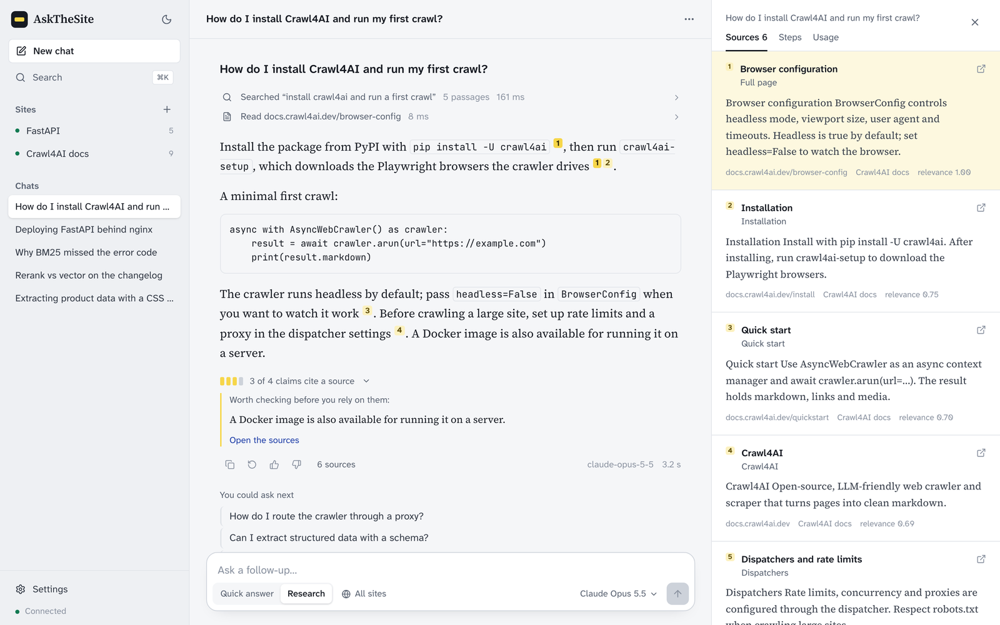

AskTheSite crawls a website, indexes it on your machine, and answers questions
about it. Unlike most "chat with your docs" tools, **every answer is
checkable**:

- each claim carries a citation number that opens the exact passage behind it,
- a grounding meter flags sentences that cite nothing,
- and the retrieval itself is inspectable, down to how three search strategies
  ranked the same question.

Use it as a quick question-answerer, or switch to **research mode** and let the
model search and read pages on its own. It runs in the browser, in the
terminal, or inside Claude Desktop, Claude Code and Cursor over MCP. With
Ollama, everything stays local and no API key is needed.

## Features

| | |
|---|---|
| **Cited answers** | Answers stream with highlighted citation numbers. Hover one to read the passage; click it to open the source with its heading, relevance score and URL. Numbers stay stable for the whole chat. |
| **Grounding meter** | Every sentence is checked for a supporting citation: "3 of 4 claims cite a source", with the uncited sentence listed so you know what to verify. |
| **Research mode** | The model drives: it searches, rephrases when results are thin, reads full pages, lists pages and compares strategies, up to a step limit. Each step is shown in plain words, with timings. |
| **Visible reasoning** | Claude's extended thinking, Ollama's native thinking, and the `<think>` text local reasoning models write inline all go into a collapsible "Reasoning" section, never into the answer. |
| **Chats with memory** | Conversations persist. A chat can search one site, several, or all of them. Edit a question, retry, duplicate, pin, export to Markdown or JSON, and full-text search every past answer. Long chats are summarised to fit small context windows. |
| **Any model** | Claude, Ollama, OpenAI, or any OpenAI-compatible server (LM Studio, vLLM, OpenRouter, Groq). Switch per chat; hide models or add new ones by id in Settings. |
| **MCP in both directions** | Serve your indexed sites to MCP clients, and give the agent tools from other MCP servers. |
| **Retrieval Lab** | One question through vector, BM25 and cross-encoder reranking at once: comparable 0–1 scores, per-strategy latency, and where the strategies agree. |
| **Link graph** | Every crawled page as a node and every internal link as an edge, coloured by distance from the start page. |
| **Terminal app** | A full-screen Textual UI with the same chats, reasoning, tool trace and sources. |

## Screenshots

| | |
|:---:|:---:|
| 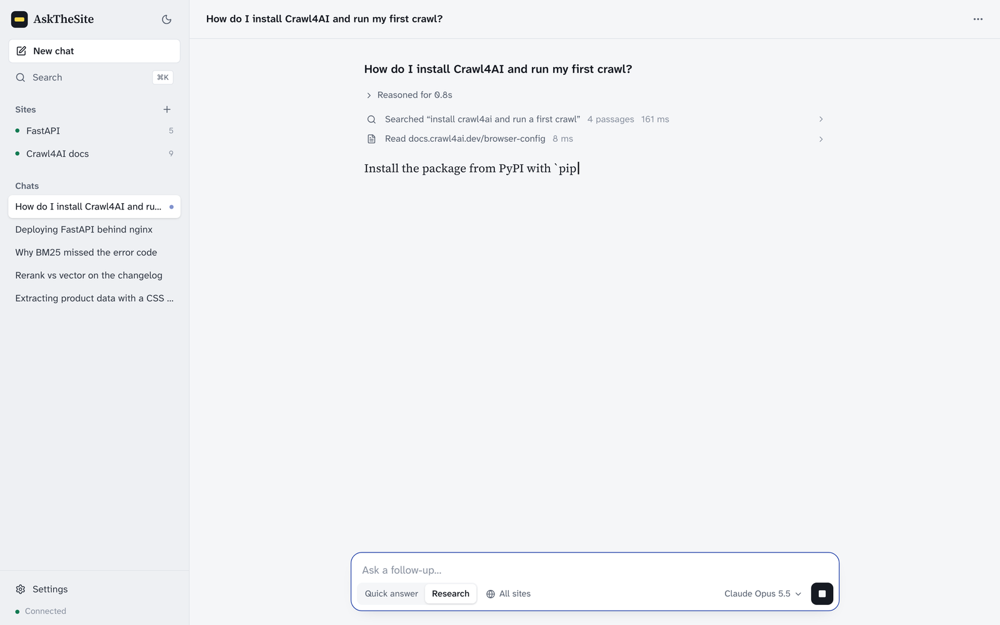 | 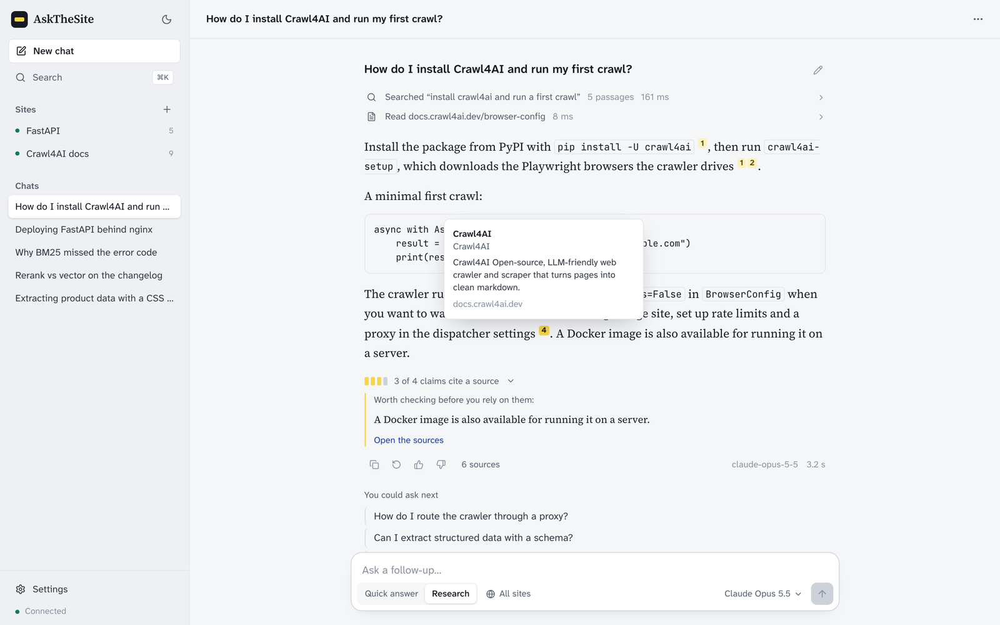 |
| **Research mode** shows its reasoning and each search as it works. | **Check any claim**: hover a citation to read the passage. |
| 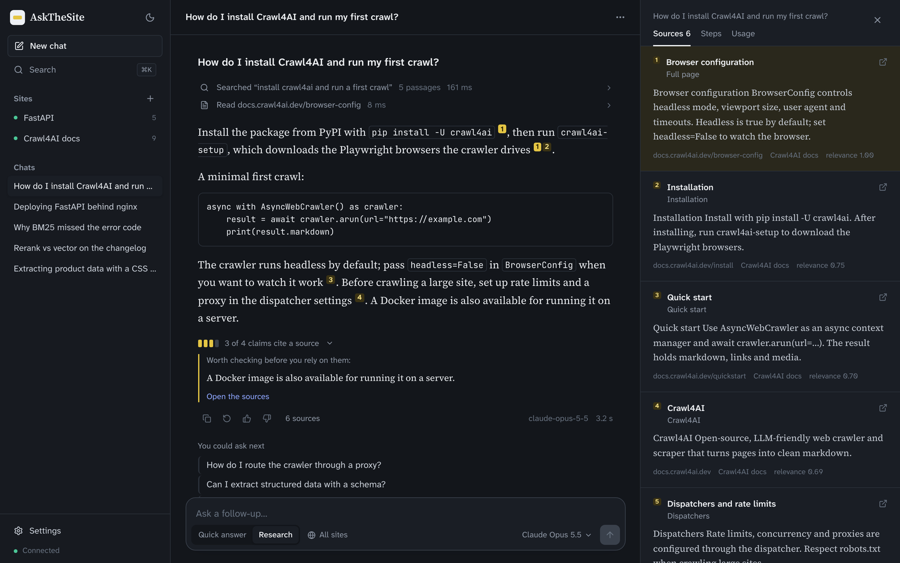 | 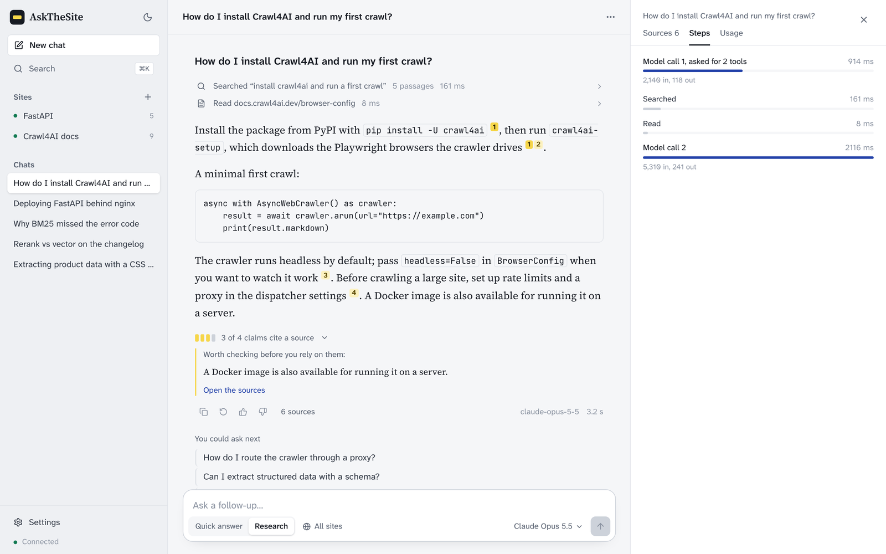 |
| **Dark theme**, with the sources panel open. | **Steps**: every model call and tool, with timing and tokens. |
| 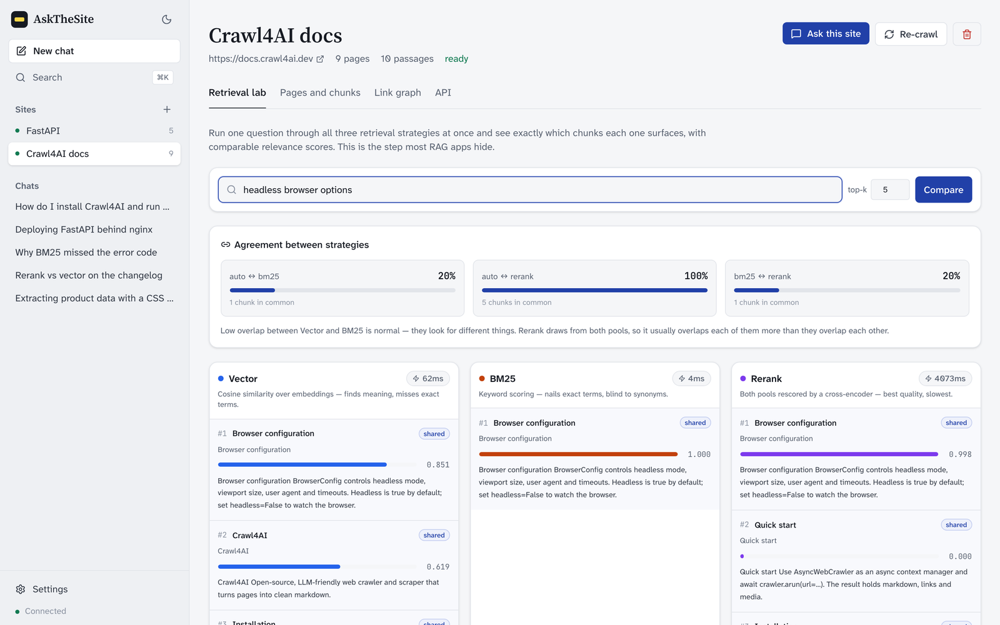 | 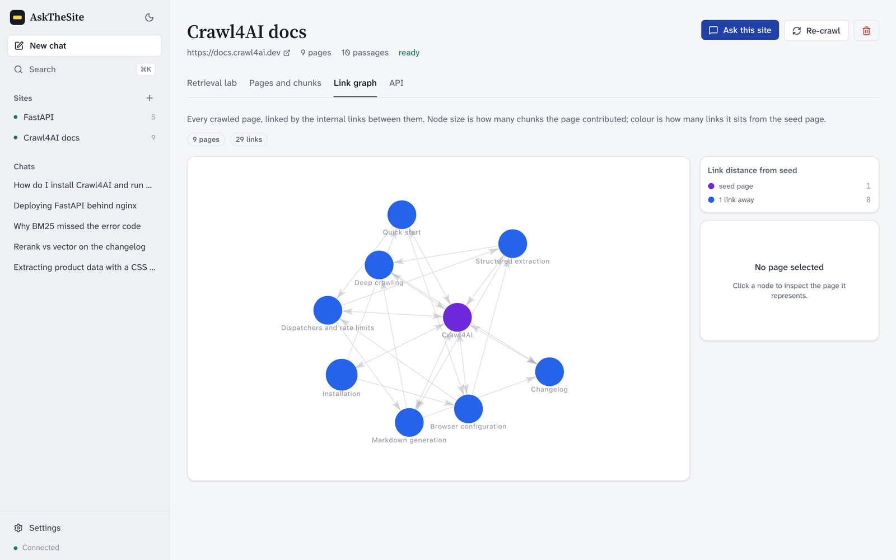 |
| **Retrieval Lab**: one question, three strategies, side by side. | **Link graph** of every crawled page. |
| 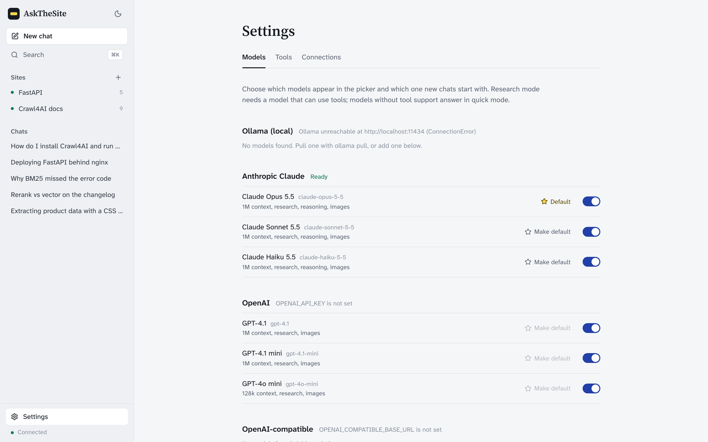 | 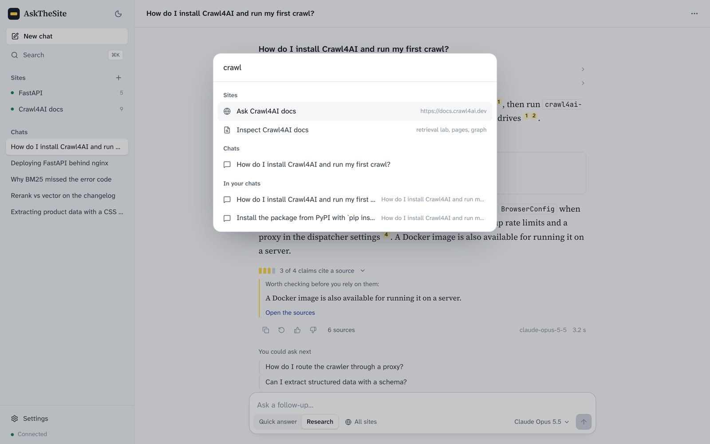 |
| **Settings** for models, tools and MCP connections. | **⌘K** searches chats, sites and past answers. |
| 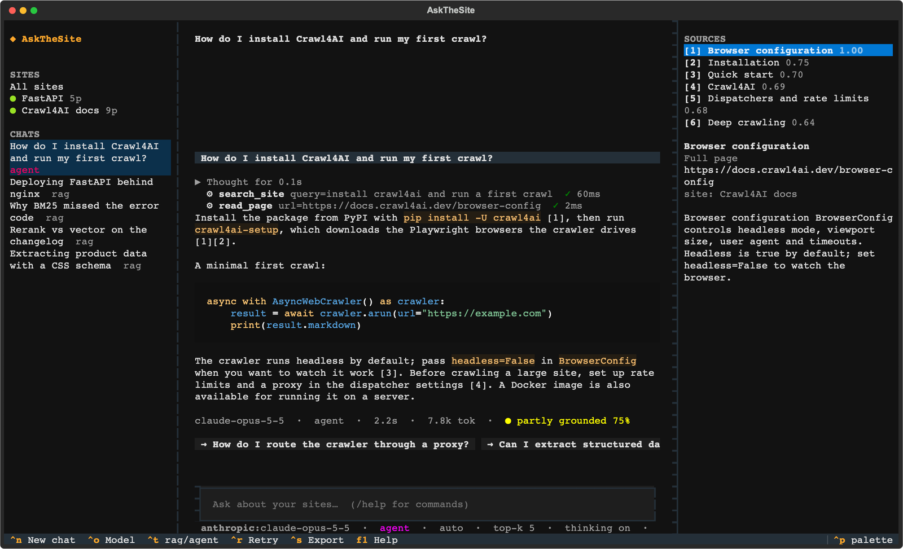 | 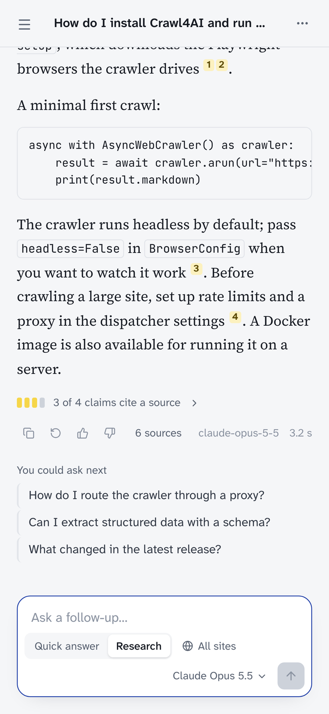 |
| **Terminal app**: `uv run main.py tui`. | **Works on a phone.** |

## How it works

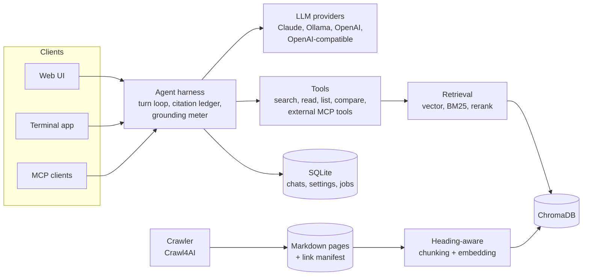

1. **Crawl.** [Crawl4AI](https://github.com/unclecode/crawl4ai) fetches pages
   (sitemap first, BFS fallback) and writes each as markdown with front-matter
   for its URL, title and outlinks, plus a manifest holding the link graph.
2. **Index.** Pages are split on their heading structure, then to size, so
   every chunk keeps the section it came from. Chunks are embedded with a
   sentence-transformer and stored in [ChromaDB](https://www.trychroma.com/).
3. **Answer.** In *quick answer* mode the best chunks go to the model once. In
   *research* mode the model calls tools in a loop until it can answer. A
   session-wide citation ledger keeps each `[n]` pointing at the same chunk for
   the whole chat.
4. **Check.** The grounding meter scores the answer and follow-up questions are
   suggested. Every message, including each tool call, is stored, so a chat
   replays exactly.

| Strategy | How it works | Score |
|---|---|---|
| `auto` | Cosine similarity over embeddings. Finds meaning, misses exact terms. | `1 − distance/2` |
| `bm25` | Keyword scoring. Nails exact terms, blind to synonyms. | Normalised by the batch maximum |
| `rerank` | Vector and BM25 candidates rescored by a cross-encoder. Best quality, slowest. | Sigmoid of the cross-encoder logit |

## Quickstart

**You need:** Python 3.11+ with [uv](https://github.com/astral-sh/uv), Node 20+
for the web UI, and either [Ollama](https://ollama.com/) (no key) or an
Anthropic / OpenAI key.

```bash
git clone https://github.com/VishvakR/AskTheSite--RAG-Agent-for-Websites.git AskTheSite
cd AskTheSite

uv sync
uv run playwright install chromium   # the crawler drives a headless browser
cp .env.example .env
```

**Pick a model.** For a fully local setup, pull a model that can use tools:

```bash
ollama pull qwen3:8b
```

```env
LLM_PROVIDER="opensource"
LLM_MODEL="qwen3:8b"
```

Or add a key for a hosted model; every provider with a key is offered in the
model picker:

```env
ANTHROPIC_API_KEY="sk-ant-..."                         # Claude Opus, Sonnet, Haiku 5.5
OPENAI_API_KEY="sk-..."
OPENAI_COMPATIBLE_BASE_URL="http://localhost:1234/v1"  # e.g. LM Studio
```

**Run it:**

```bash
uv run uvicorn server:app --port 8000           # API on :8000
cd frontend && npm install && npm run dev       # web UI on :5173
```

Open <http://localhost:5173>, choose **Add a site**, and point it at a docs
site. When the crawl finishes, ask away. Research mode needs a model that
supports tool calling; other models answer in quick mode automatically.

> **Docker:** `docker compose up --build` runs the API with persistent volumes
> for the index, crawled pages and model cache, and reaches an Ollama on the
> host via `host.docker.internal`.

## Terminal app

```bash
uv run main.py tui
```

Sites and chats on the left, the conversation in the middle with reasoning and
tool calls folded inline, and the sources of the latest answer on the right.
It runs everything in-process, so no API server is needed.

| Key | Action | | Command | Action |
|---|---|---|---|---|
| <kbd>Enter</kbd> | send | | `/mode rag\|agent` | quick answer or research |
| <kbd>Esc</kbd> | stop answering | | `/model provider:model` | switch model |
| <kbd>Ctrl N</kbd> | new chat | | `/site <name\|all>` | which sites to search |
| <kbd>Ctrl O</kbd> | pick a model | | `/crawl <url> [site]` | index a page or a site |
| <kbd>Ctrl T</kbd> | toggle research | | `/think off\|on\|high` | reasoning |
| <kbd>Ctrl R</kbd> | retry | | `/search <words>` | search past chats |
| <kbd>Ctrl S</kbd> | export Markdown | | `/fork` `/rename` `/delete` | manage the chat |
| <kbd>F1</kbd> | help | | `/engine` `/topk` | retrieval settings |

One-off commands are also available:

```bash
uv run main.py crawl https://docs.crawl4ai.com --mode site --max-pages 25
uv run main.py list
uv run main.py ask <site-id> "How do I install it?"
uv run main.py compare <site-id> "installation steps"
```

## MCP

### Use your sites from Claude Desktop, Claude Code or Cursor

AskTheSite is an MCP server with the tools `list_workspaces`, `search_site`,
`read_page`, `list_pages`, `compare_retrieval` and `ask` (a full cited answer),
plus each site's page list as a resource. Add it to your client's config:

```json
{
  "mcpServers": {
    "askthesite": {
      "command": "uv",
      "args": ["--directory", "/path/to/AskTheSite", "run", "main.py", "mcp"]
    }
  }
}
```

With Claude Code:

```bash
claude mcp add askthesite -- uv --directory /path/to/AskTheSite run main.py mcp
```

While the API is running, the same server is also available over Streamable
HTTP at `http://localhost:8000/mcp`. Behind a proxy, list your host in
`MCP_ALLOWED_HOSTS`.

### Give the agent tools from other MCP servers

Under **Settings → Connections**, add a local command (for example
`npx -y @modelcontextprotocol/server-everything`) or a remote URL with
headers. Their tools become available in research mode as
`mcp__<server>__<tool>`, and each can be switched off under **Settings →
Tools**. Values of environment variables and headers are never sent back to
the browser.

## HTTP API

Interactive docs are at <http://localhost:8000/docs>. The main endpoints:

| Method | Path | Purpose |
|---|---|---|
| `POST` | `/workspaces` | Add a site and start crawling; returns a job |
| `GET` | `/workspaces`, `/workspaces/{id}` | List sites or fetch one |
| `POST` | `/workspaces/{id}/reindex` | Re-crawl and rebuild the index |
| `GET` | `/workspaces/{id}/documents`, `/pages`, `/graph` | Chunks, crawl manifest, link graph |
| `POST` | `/workspaces/{id}/retrieval/compare` | All three strategies at once |
| `POST`, `GET` | `/sessions` | Start or list chats |
| `GET`, `PATCH`, `DELETE` | `/sessions/{id}` | A chat with its turns; rename, pin, change model or mode |
| `POST` | `/sessions/{id}/chat/stream` | Ask in a chat (server-sent events) |
| `POST` | `/sessions/{id}/cancel`, `/fork` | Stop an answer, duplicate a chat |
| `GET` | `/sessions/{id}/export`, `/sessions/search` | Download a chat, search all chats |
| `GET`, `POST`, `PATCH` | `/models`, `/tools`, `/mcp/servers` | Model, tool and MCP settings |
| `GET` | `/jobs/{id}/events` | Live crawl progress (server-sent events) |

A chat stream emits `turn`, then `thinking`, `token`, `tool_call`,
`tool_result`, `sources` and `usage` as they happen, then `answer`,
`grounding`, `followups` and finally `done` (or `error`):

```bash
curl -N -X POST localhost:8000/sessions/<id>/chat/stream \
  -H 'Content-Type: application/json' \
  -d '{"prompt": "How do I install it?", "mode": "agent"}'
```

Set `API_TOKEN` to require `Authorization: Bearer <token>` on every call
except `/health` and the docs.

## Configuration

All settings live in `.env`; `.env.example` lists every one.

| Variable | Default | Purpose |
|---|---|---|
| `LLM_PROVIDER` | `opensource` | Default provider until you choose one in Settings: `opensource` (Ollama), `anthropic`, `openai`, `openai_compatible` |
| `LLM_MODEL` | `qwen3.5:4b-mlx` | Default Ollama model |
| `ANTHROPIC_API_KEY`, `OPENAI_API_KEY` | — | Keys for hosted models |
| `OPENAI_COMPATIBLE_BASE_URL` | — | Any OpenAI-compatible server |
| `LLM_THINKING`, `LLM_EFFORT` | `true`, — | Ask for visible reasoning; effort `low`, `medium` or `high` |
| `AGENT_MAX_STEPS` | `8` | Model calls allowed per research answer |
| `AGENT_ALLOW_FETCH` | `false` | Let the agent fetch live pages outside the index |
| `AGENT_FOLLOWUPS` | `true` | Suggest follow-up questions |
| `API_TOKEN` | — | Require a bearer token on the API |
| `MCP_ALLOWED_HOSTS` | localhost | Hosts `/mcp` accepts behind a proxy |
| `CRAWL_MAX_PAGES` | `100` | Default page cap for a site crawl |
| `MAX_CONCURRENT_JOBS` | `2` | Crawls and indexing jobs run in parallel |
| `PERSISTENT_STORAGE`, `WORKSPACE_ROOT` | `./storage/cache`, `./workspaces` | Where the index and crawled pages live |

## Development

```bash
uv run pytest                                   # backend tests, fully offline
cd frontend && npm run lint && npm run build    # web UI checks
```

The test suite needs no network or model: a fake provider, registered through
the same factory as the real ones, also plays the agent. Every test runs
against a temporary storage root. It covers the harness, sessions and
migrations, the HTTP API, both MCP directions (including a real stdio round
trip), and the terminal app through Textual's headless pilot.

```
app/
├── agent/       turn loop, tools, citation ledger, grounding meter
├── api/         FastAPI routers, one per area
├── catalog/     SQLite with versioned migrations
├── crawler/     Crawl4AI wrapper, page front-matter, link manifest
├── index/       Chroma index and scored retrieval
├── ingestion/   heading-aware chunking
├── jobs/        background jobs with live progress
├── llm/         providers, model specs, streamed thinking and tool calls
├── mcp/         MCP server and client
├── services/    site and chat orchestration
└── tui/         Textual terminal app
frontend/        React 19, Vite, Tailwind CSS 4
tests/           pytest suite
main.py          CLI: crawl, ask, compare, tui, mcp
server.py        builds the FastAPI app
```

## License

[MIT](LICENSE)
